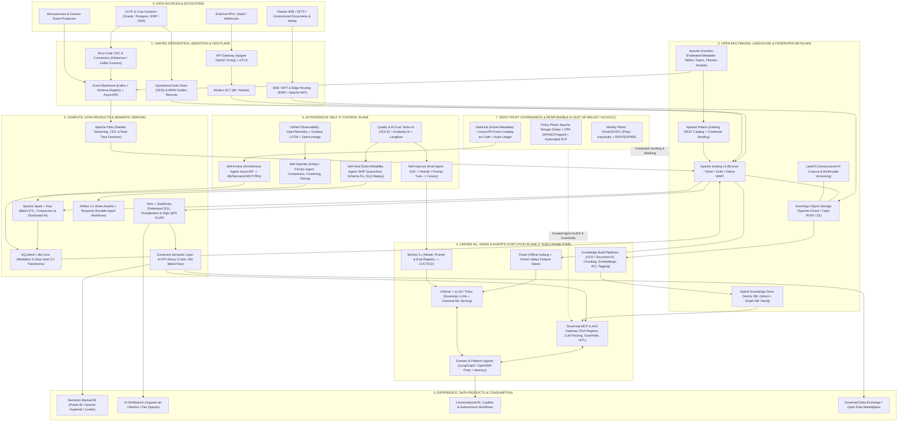

# AegisLake — Self-Evolving Agentic Data & AI Platform

[](LICENSE)
[](docs/architecture/01-system-context-and-layers.md)
[](docs/architecture/03-zero-trust-responsible-ai-governance.md)
[](contracts/)

**AegisLake** is a vendor-neutral, enterprise-grade reference architecture for a **Self-Operating, Self-Healing, Self-Evolving, Self-Improving, Self-Governing, and Self-Scaling Agentic Data & AI Lakehouse**.

Designed for regulated national-scale enterprises (government, financial services, insurance, telecom), AegisLake unifies:
- **Open Multimodal Lakehouse** (`Apache Ozone / Ceph RGW`, `Apache Iceberg v3`, `Apache Polaris`, `Apache Gravitino`, `LakeFS`, `Qdrant`)
- **Event-First Integration & Operational Data Store** (`Confluent Kafka / Strimzi`, `Debezium CDC`, `Informatica IDMC / NiFi`, `dlt`, `Apigee Hybrid`, `ODS + MDM Golden Records`)
- **Elastic Compute, Data Products & Semantic Serving** (`Apache Flink`, `Apache Spark + Ray`, `SQLMesh / dbt`, `Trino + StarRocks`, `Cube / dbt MetricFlow`, `Airflow 3.x + Temporal`)
- **7-Layer GenAI, MLOps & Governed Agentic Runtime** (`Feast`, `MLflow 3.x`, `KServe + vLLM / Triton`, `LangGraph`, `Governed MCP & A2A Gateway`, `Evidently AI`, `Langfuse`)
- **6 Autonomous "Self-X" Control Loops** backed by `OpenTelemetry`, `OpenLineage`, `DataHub`, `Apache Ranger`, `OPA`, and `KEDA` on Red Hat OpenShift / Kubernetes
- **Dual Sovereign On-Premises & Cloud-Native Deployment Mapping** (balancing strict data sovereignty with frontier AI velocity)

---

## Target Reference Architecture



---

## Core Architectural Pillars

### 1. Six Autonomous "Self-X" Control Loops
| Capability | Trigger Signals | Autonomous Action | Human-in-the-Loop (HITL) Gate |
| :--- | :--- | :--- | :--- |
| **Self-Operate** | Iceberg small-file ratio, query latency, storage heat | Automated Iceberg compaction, Z-order/liquid clustering, snapshot expiration, cold tiering | Cost-ceiling policy via OPA |
| **Self-Heal** | Soda v4 contract failure, schema drift, Evidently anomaly | Isolates data on Iceberg **WAP branch**, quarantines bad records, proposes schema cast, replays Kafka DLQ via Temporal | Auto-heal for additive/quarantine rules; PR approval for breaking schema changes |
| **Self-Evolve** | New AsyncAPI spec or Schema Registry version | Scaffolds Bronze/Silver SQLMesh/dbt models, ODCS data contracts, semantic KPIs, and MCP tool stubs | Architecture & Domain Steward PR review |
| **Self-Improve** | Langfuse faithfulness/latency drop or Evidently model drift | Triggers Feast feature refresh, MLflow retraining or RAG/prompt sweep, evaluates shadow KServe canary | Automated promotion only if statistical uplift & fairness gates pass |
| **Self-Govern** | Access requests, PII discovery, agent tool invocation | Automated DLP tagging, Ranger row/column masking, Polaris short-lived credential vending, OPA MCP guardrails | Policy-as-code review via GitOps |
| **Self-Scale** | Kafka consumer lag, Trino queue depth, GPU TTFT | KEDA autoscaling for Flink/workers, Spark dynamic allocation, KServe/vLLM GPU scale-to-zero & burst | Budget quota enforcement |

### 2. Five Enterprise AI Use-Case Archetypes Supported
1. **Analytical AI** — Prediction, classification, anomaly detection (`Spark`, `Feast`, `MLflow`, `Triton/ONNX`).
2. **Generative AI** — Summarization, RAG, conversational BI, multilingual content (`Document AI/OCR`, `Qdrant`, `vLLM`, `Langfuse`).
3. **Perception AI** — OCR, NLP/NLU, speech-to-text/TTS, computer vision, IoT/sensor (`Ray`, `LakeFS` multimodal corpora, `KServe`).
4. **Autonomous AI** — Multi-step agentic workflows and event-driven automation (`LangGraph`, `Temporal`, `MCP/A2A Gateway`).
5. **Decision AI** — Recommendations, simulations, policy/rules and optimization engines (`Semantic Layer`, `StarRocks`, `Decision APIs`).

### 3. Critical 2026 Lifecycle Decisions (Why This Differs From Legacy Diagrams)
- **Replaced MinIO Community Edition -> Apache Ozone / Ceph RGW** ([ADR-001](docs/adr/ADR-001-object-storage-ozone-ceph-over-minio-ce.md)): MinIO CE was archived in 2026 with unpatched CVEs and removed anonymous container pulls.
- **Replaced WhyLabs -> Langfuse + Evidently AI** ([ADR-004](docs/adr/ADR-004-ai-observability-langfuse-evidently-over-whylabs.md)): WhyLabs discontinued commercial operations in 2026; dual open-source observability covers both classical ML drift and LLM/agent traces.
- **Replaced n8n for Analytical ELT -> dlt / Debezium Kafka Connect** ([ADR-006](docs/adr/ADR-006-event-backbone-kafka-cdc-dlt-over-n8n.md)): Workflow tools lack schema contracts, CDC checkpointing, and bulk throughput.
- **Added Governed Semantic Layer + Federated Metalake (Gravitino + Polaris)** ([ADR-002](docs/adr/ADR-002-federated-metalake-gravitino-plus-polaris.md), [ADR-005](docs/adr/ADR-005-semantic-layer-and-governed-mcp-gateway.md)): Prevents KPI drift across BI tools and eliminates LLM SQL hallucinations.

---

## Repository Structure

```text
Agentic-Data-Platform/
├── README.md
├── LICENSE
├── CONTRIBUTING.md
├── docker-compose.local.yml
├── docs/
│   ├── architecture/
│   │   ├── 01-system-context-and-layers.md
│   │   ├── 02-self-x-autonomous-control-plane.md
│   │   ├── 03-zero-trust-responsible-ai-governance.md
│   │   ├── 04-component-benchmark-and-market-analysis.md
│   │   └── 05-hybrid-sovereign-vs-cloud-mapping.md
│   └── adr/
│       ├── ADR-001-object-storage-ozone-ceph-over-minio-ce.md
│       ├── ADR-002-federated-metalake-gravitino-plus-polaris.md
│       ├── ADR-003-versioning-iceberg-wap-vs-lakefs.md
│       ├── ADR-004-ai-observability-langfuse-evidently-over-whylabs.md
│       ├── ADR-005-semantic-layer-and-governed-mcp-gateway.md
│       └── ADR-006-event-backbone-kafka-cdc-dlt-over-n8n.md
├── contracts/
│   ├── data-contracts/
│   │   └── customer_claims_gold.odcs.yaml
│   └── event-catalog/
│       └── claims-events.asyncapi.yaml
├── platform/
│   ├── openshift-gitops/
│   │   └── keda-flink-autoscaler.yaml
│   ├── policies/opa/
│   │   └── mcp_agent_guardrails.rego
│   └── observability/
│       └── otel-collector-config.yaml
└── agents/
    ├── mcp-servers/
    │   └── lakehouse_mcp_server.py
    └── self-healing/
        └── wap_reliability_agent.py
```

---

## Quickstart (Local Architecture Sandbox)

```bash
# 1. Launch local Iceberg REST Catalog (Polaris), S3-compatible storage (SeaweedFS),
#    Trino query engine, OPA Policy Engine, Valkey online store, and OpenTelemetry Collector
docker compose -f docker-compose.local.yml up -d

# 2. Verify OPA MCP Agent Guardrail policy
curl -s -X POST http://localhost:8181/v1/data/aegislake/mcp/allow \
  -H "Content-Type: application/json" \
  -d '{"input":{"agent_role":"data_analyst_agent","tool":"query_semantic_kpi","contains_pii":false,"mutation":false}}'

# 3. Run the Self-Healing WAP Reliability Agent simulation
python3 agents/self-healing/wap_reliability_agent.py
```

---

## Author

**Ahmed Salem** — Enterprise Integration & Data Architect (API · Events · Lakehouse · Agentic AI)
- GitHub: [github.com/salemfcih/Agentic-Data-Platform](https://github.com/salemfcih/Agentic-Data-Platform)
- LinkedIn: [linkedin.com/in/ahmedmohamed-salem-89194697](https://linkedin.com/in/ahmedmohamed-salem-89194697)
